<div align="center">


# Route Tracking Distrava

**Offline-first bike ride tracker for Android.**
Record your rides on an offline map and share a ready-to-post summary image, with no account, no server and no internet required.

[](#requirements)
[](#requirements)
[](https://kotlinlang.org)
[](https://developer.android.com/jetpack/compose)
[](#releases)

[Features](#features) · [How it works](#how-it-works) · [Requirements](#requirements) · [Build](#building-from-source) · [Offline maps](#offline-maps) · [Releases](#releases) · [Docs](#documentation)

</div>

---

## Why distrava?

Most ride trackers depend on a phone signal and a cloud account. distrava is built for the opposite case: you ride a trail or a road with no coverage, and you still want a record of the route and a picture to share afterwards.

- **Offline first.** Once a region map is installed, nothing depends on the network.
- **One tap to start.** The home screen is the map, with a **Start** button.
- **Reliable recording.** A ride is never lost, even if the app is closed or the phone restarts.
- **Private by default.** No sign-up, no ads, no analytics. Data leaves the device only when you share an image.

## Features

- 🗺️ **Offline vector maps** (MapLibre + PMTiles) on the home screen, centered on your position.
- ▶️ **Start / finish a ride** with a foreground service, so recording continues with the screen off.
- 📈 **Live route** drawn in orange on the map, with elapsed time, distance and current speed.
- 📊 **Ride statistics**: total time, moving time, distance, average speed (moving time based) and max speed (GPS spikes filtered out).
- ⛰️ **Elevation**: total climb and descent, plus an elevation profile chart in the ride details.
- 📍 **Points of interest**: long-press the map to mark water, a bike shop, a restroom, food or anything else. Tap a point to see or delete it.
- 🟣 **Previous rides on the map**: a toggle draws your past routes as thin purple lines under the current route.
- 🌙 **Dark mode**: one tap switches the whole app, map included, to a dark theme for night rides. It follows the system theme until you choose.
- 🖼️ **Summary image** (1080 × 1920, Stories format) with the route drawn over the offline map. Save it to the gallery or share it through the Android share sheet.
- 🕘 **History** of rides, with a route thumbnail, details view and deletion.
- 🧭 **Crash-safe recovery**: if the system kills the app mid-ride, you can resume or finish it when you reopen the app.
- 📦 **Map manager**: import or remove `.pmtiles` regions from the device.
- 🧪 **Ride simulator** in debug builds, so you can test the whole flow without leaving home.

## Screenshots

<div align="center">

<table>
  <tr>
    <td align="center">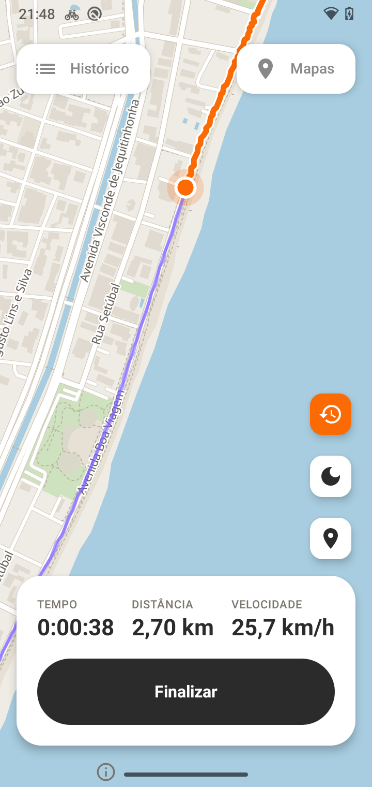<br/><sub>Live recording, previous ride in purple</sub></td>
    <td align="center">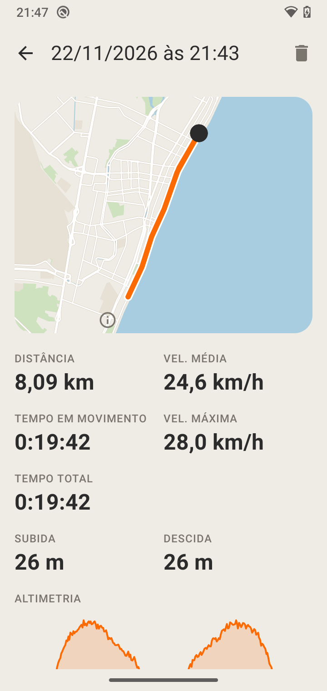<br/><sub>Ride summary</sub></td>
    <td align="center">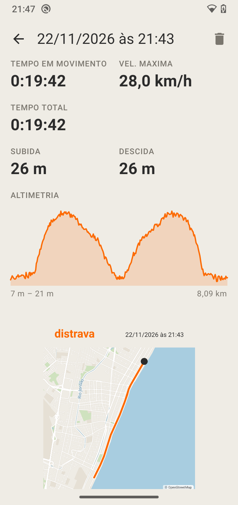<br/><sub>Elevation and share image</sub></td>
  </tr>
  <tr>
    <td align="center">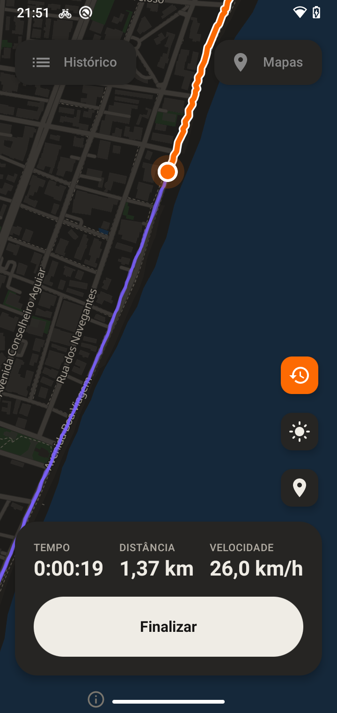<br/><sub>Dark mode</sub></td>
    <td align="center">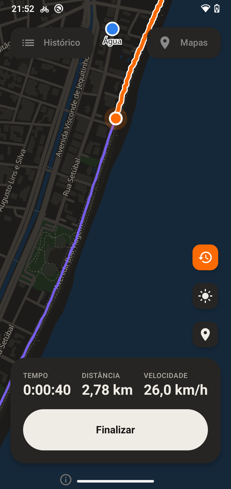<br/><sub>Point of interest</sub></td>
    <td align="center">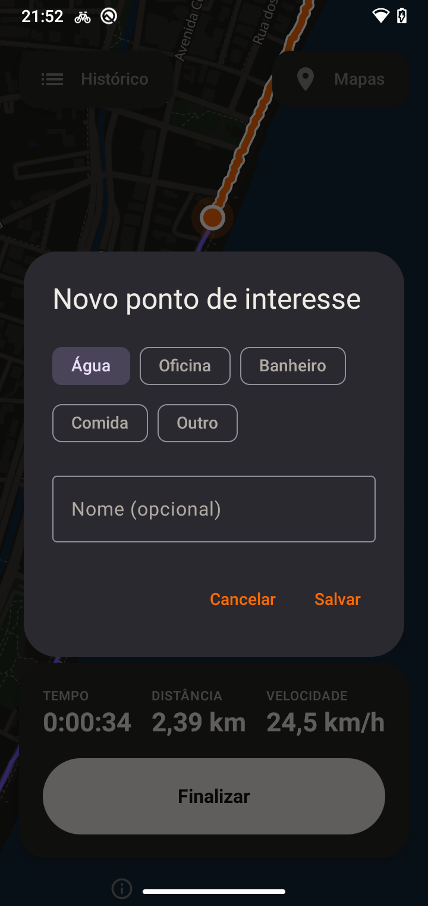<br/><sub>Marking a point</sub></td>
  </tr>
  <tr>
    <td align="center">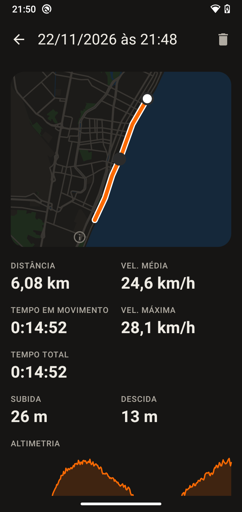<br/><sub>Summary, dark</sub></td>
    <td align="center">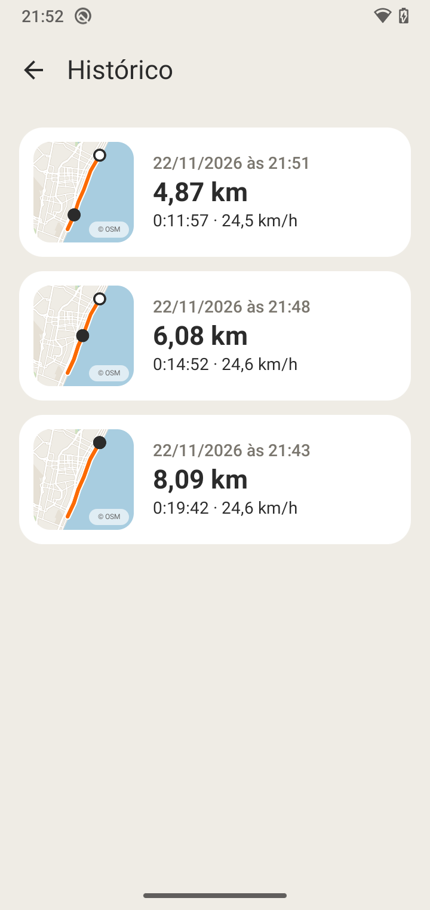<br/><sub>History</sub></td>
    <td align="center">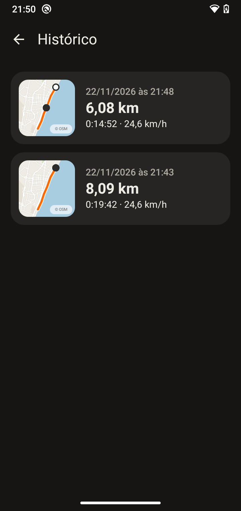<br/><sub>History, dark</sub></td>
  </tr>
  <tr>
    <td align="center">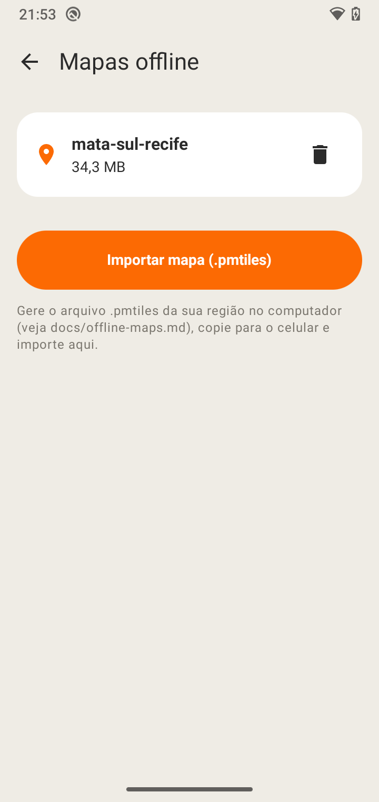<br/><sub>Offline maps</sub></td>
    <td align="center">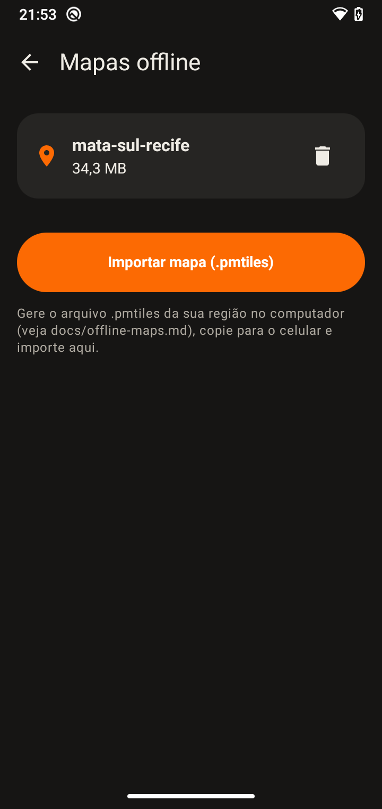<br/><sub>Offline maps, dark</sub></td>
    <td></td>
  </tr>
</table>

<sub>Screenshots taken with the debug ride simulator on Av. Boa Viagem (Recife), with location permission denied, so they show no real position.</sub>

</div>

## How it works

1. **Install a map** for your region. A default map is bundled into the APK and installed on first launch. Other regions can be generated and imported (see [Offline maps](#offline-maps)).
2. **Tap Start.** The app requests location permission (if needed), starts a foreground service and begins recording GPS points every second in high-accuracy mode.
3. **Ride.** The route is drawn live. Noisy GPS points are filtered out before they reach the statistics.
4. **Finish.** Confirm the end of the ride. Very short rides (less than 2 valid points or less than 50 m) are discarded with a warning. Otherwise the ride is saved to a local database.
5. **Share.** The summary image is rendered offline from the map tiles and the recorded route. Save it or share it.

### Statistics

| Metric | Definition |
|---|---|
| Total time | end time minus start time |
| Moving time | sum of intervals where speed is above 1 km/h |
| Distance | sum of distances between consecutive valid points (Haversine) |
| Average speed | distance / moving time, so stops don't drag the average down |
| Max speed | 95th percentile of 5-second moving averages, skipping windows with GPS accuracy worse than 15 m |
| Climb / descent | sum of rises and drops of the smoothed GPS altitude, counted only after a 3 m change |

## Tech stack

| Layer | Choice |
|---|---|
| Language | Kotlin 2.0.21 (Compose compiler plugin), Java bytecode 17 |
| UI | Jetpack Compose with Material 3 (BOM 2024.10.01) |
| Navigation | Navigation Compose 2.8.4 |
| Map | [MapLibre Native Android](https://maplibre.org) 11.13.5 |
| Map data | [PMTiles](https://github.com/protomaps/PMTiles) v3, [Protomaps](https://protomaps.com) basemap, © OpenStreetMap contributors |
| Location | Google Play Services Location 21.3.0 (`FusedLocationProviderClient`) |
| Persistence | Room 2.6.1 with KSP |
| Concurrency | Kotlin Coroutines and Flow |
| Build | Gradle 8.6 wrapper, Android Gradle Plugin 8.4.2 |

## Architecture

distrava is a single-Activity Compose app with unidirectional data flow:

```
UI (Composables) --events--> Service / Repository --> Room
       ^                              |
       +------- StateFlow / Flow -----+
```

- **Recording state** lives in a `StateFlow` (`Idle`, `Recording`, `Finishing`, `Finished`, `Discarded`). The service writes it and the UI observes it, so the result is not lost when the UI is recreated.
- **Dependencies** are provided by a manual `AppContainer` created in `DistravaApp`. There is no DI framework, to keep the setup small.
- **Pure logic** (`Geo`, `LocationFilter`, `StatsCalculator`, `ElevationCalculator`, `RouteProjection`, `Format`) is plain Kotlin and covered by unit tests.

### Project structure

```
app/src/main/java/com/distrava/app/
├── DistravaApp.kt            # Application class and AppContainer
├── MainActivity.kt           # NavHost and debug simulator trigger
├── ui/
│   ├── map/                  # home screen, live recording, MapLibre in Compose, points of interest
│   ├── history/              # ride list, detail screen and elevation chart
│   ├── offlinemaps/          # import and remove map regions
│   └── theme/                # colors and theme
├── recording/
│   ├── RecordingService.kt   # foreground location service
│   ├── LocationFilter.kt     # drops bad GPS points
│   ├── StatsCalculator.kt    # time, distance and speeds
│   ├── Elevation.kt          # climb, descent and elevation profile
│   └── RideSimulator.kt      # fake route for testing (debug)
├── data/
│   ├── db/                   # Room entities, DAOs and database (rides, points, points of interest)
│   └── ActivityRepository.kt # save, finish, image generation, delete
├── maps/
│   ├── OfflineMapStore.kt    # .pmtiles files in filesDir/maps
│   └── MapStyle.kt           # builds the MapLibre style JSON (light and dark)
└── share/
    ├── SummaryImageRenderer.kt  # 1080 × 1920 PNG
    └── ImageExporter.kt         # MediaStore gallery and FileProvider sharing
```

## Requirements

### To use the app

- Android 8.0 (API 26) or newer.
- An arm64-v8a or armeabi-v7a device with GPS.
- Location permission and GPS enabled.
- Disable battery optimization for distrava. The app suggests this on the first ride, because some manufacturers stop the recording when the screen is off otherwise.

### To build from source

| Tool | Version / notes |
|---|---|
| JDK | 21 (bytecode target is Java 17) |
| Android SDK | `platforms;android-34`, `build-tools;34.0.0`, `platform-tools` |
| Gradle | Not needed. The project uses the included Gradle wrapper (8.6) |
| Internet | Required on the first build to download dependencies |
| Python 3 | Only to generate offline map files (standard library only) |

Android Studio is **not** required. Everything works from the command line.

Example setup on Linux (add to your shell profile):

```sh
export JAVA_HOME=/usr/lib/jvm/java-21-openjdk-amd64
export ANDROID_HOME=$HOME/Android/Sdk
export ANDROID_SDK_ROOT=$ANDROID_HOME
export PATH=$JAVA_HOME/bin:$ANDROID_HOME/platform-tools:$ANDROID_HOME/cmdline-tools/latest/bin:$PATH
```

Install the SDK packages with `sdkmanager`:

```sh
sdkmanager "platforms;android-34" "build-tools;34.0.0" "platform-tools"
```

## Building from source

Clone the repository and run the commands from the project root.

```sh
git clone https://github.com/kaio-souza/distrava.git
cd distrava
```

### 1. Generate the bundled map

The default map is embedded into the APK. Create it before building (see [Offline maps](#offline-maps)):

```sh
python3 tools/pmtiles_extract.py maps/mata-sul-recife.pmtiles --bbox=-35.95,-9.00,-34.80,-7.90
```

If the file is missing, the build still works, but the APK ships without a map and the user has to import one.

### 2. Build and install

```sh
./gradlew assembleDebug            # debug APK: app/build/outputs/apk/debug/
./gradlew installDebug             # install on a connected device
./gradlew testDebugUnitTest        # run unit tests
```

Launch and follow the log from the terminal:

```sh
adb shell am start -n com.distrava.app.debug/com.distrava.app.MainActivity
adb logcat --pid=$(adb shell pidof com.distrava.app.debug)
```

### Testing without leaving home

Debug builds use the package `com.distrava.app.debug`, so they install next to the release app with separate data. They include a ride simulator: a fake route along Av. Boa Viagem (Recife), out and back, running 10× faster than real time. Tap the test button below the Start button (labeled in Portuguese in the app), or launch the app with:

```sh
adb shell am start -n com.distrava.app.debug/com.distrava.app.MainActivity --ez simulate_ride true
```

Real GPS needs a clear view of the sky. Indoors the signal is usually too weak, so test near a window or outside.

## Offline maps

distrava reads maps in the [PMTiles](https://github.com/protomaps/PMTiles) format. Coverage is Brazil, one file per state or custom region.

### Generate a region

`tools/pmtiles_extract.py` downloads only the tiles inside a bounding box from the daily Protomaps build, using HTTP range requests, and writes a new, smaller PMTiles file:

```sh
python3 tools/pmtiles_extract.py mata-sul-recife.pmtiles --bbox=-35.95,-9.00,-34.80,-7.90
```

| Option | Purpose |
|---|---|
| `--bbox=LON_MIN,LAT_MIN,LON_MAX,LAT_MAX` | region rectangle (required) |
| `--maxzoom=N` | maximum zoom level (default 15; lower means smaller file and less street detail) |
| `--source=URL` | another PMTiles source, for example a specific build date |

Ready-made boxes:

| Region | bbox | Approx. size |
|---|---|---|
| Mata Sul + Recife | `-35.95,-9.00,-34.80,-7.90` | 36 MB |
| Pernambuco (mainland) | `-41.40,-9.50,-34.80,-7.25` | to be measured |

### Install a map on the phone

- **Bundled:** placing the file in `maps/` before building embeds it in the APK, and the app installs it on first launch.
- **Manually:** copy the file to the device and open **Mapas > Importar mapa (.pmtiles)** in the app (the UI is in Brazilian Portuguese; the menu means "Maps > Import map"). The file name becomes the region name. Importing a file with the same name replaces the existing region.

```sh
adb push mata-sul-recife.pmtiles /sdcard/Download/
```

## Releases

### Build a release APK

1. **Bump the version** in `app/build.gradle.kts`:

   ```kotlin
   versionCode = 2          // must increase on every release
   versionName = "0.2.0"
   ```

2. **Run the tests:**

   ```sh
   ./gradlew testDebugUnitTest
   ```

3. **Make sure the bundled map exists** in `maps/` (see [Building from source](#1-generate-the-bundled-map)), or choose another region with `-PdefaultMap=<name>` (for example `-PdefaultMap=pernambuco`, which reads `maps/pernambuco.pmtiles`).

4. **Assemble the release:**

   ```sh
   ./gradlew assembleRelease
   ```

   The output is `app/build/outputs/apk/release/app-release.apk`. The APK includes only the `arm64-v8a` and `armeabi-v7a` native libraries. Minification is currently disabled (`isMinifyEnabled = false`), so the APK is roughly the size of the bundled map plus the app.

5. **Check the APK** on a real device: install it with `adb install -r app/build/outputs/apk/release/app-release.apk`, then run through the ride flow with real GPS.

> [!WARNING]
> The release build is currently signed with the **debug key** (see the `TODO` in `app/build.gradle.kts`). That is fine for testing on your own devices, but **not** for distribution. Before publishing, create a release keystore and configure a `signingConfigs.release` block that reads its passwords from `local.properties` or environment variables, never from the repository.

### Publish on GitHub

Using the [GitHub CLI](https://cli.github.com):

```sh
git tag v0.2.0
git push origin v0.2.0
gh release create v0.2.0 app/build/outputs/apk/release/app-release.apk \
  --title "distrava v0.2.0" \
  --notes "Release notes here."
```

Release APKs are not committed to the repository. `*.apk` and `maps/*.pmtiles` are in `.gitignore`.

## Roadmap

- [ ] Field test: real 30+ minute ride with the screen off, checking distance accuracy, battery use (target ≤ 8% per hour) and lost points (target ≤ 5 s on abrupt shutdown).
- [ ] Generate and measure the full Pernambuco map.
- [ ] Signed release build with a dedicated keystore.
- [ ] Download regions by state from the project, instead of manual import.
- [ ] Pause and resume a ride manually.
- [ ] Export GPX.
- [ ] Extra share format (1080 × 1350 feed image).

Out of scope for the MVP: user accounts, cloud sync, social features, segments, Strava integration, other sports, and iOS/web.

## Documentation

Detailed project documents:

| Document | Content |
|---|---|
| [docs/product.md](docs/product.md) | Vision, scope, functional and non-functional requirements with acceptance criteria, screens, summary image layout |
| [docs/technical.md](docs/technical.md) | Stack, architecture, recording pipeline, data, maps, permissions, tests |
| [docs/offline-maps.md](docs/offline-maps.md) | How to generate and install offline maps |
| [docs/decisions.md](docs/decisions.md) | Recorded decisions and open questions |

## Status

**v0.1.0 (MVP)** is implemented and has been tested on a physical device with a simulated ride. Field testing with real GPS is still pending.

Measured performance (RAM, CPU, cold start) on a Moto G7 Power is in [docs/technical.md, section 9](docs/technical.md#9-measured-performance).

## Licensing and attribution

- Map data © [OpenStreetMap](https://www.openstreetmap.org/copyright) contributors, licensed under the [ODbL](https://opendatacommons.org/licenses/odbl/).
- Basemap tiles from [Protomaps](https://protomaps.com).
- The in-app map attribution is available from the map's info button.
